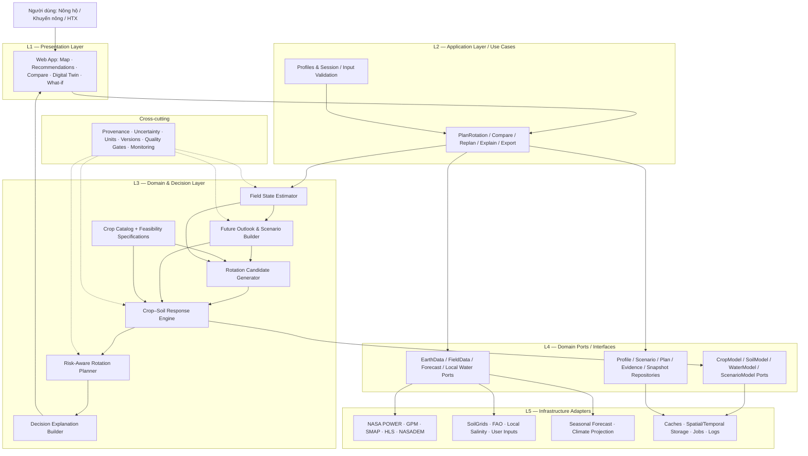
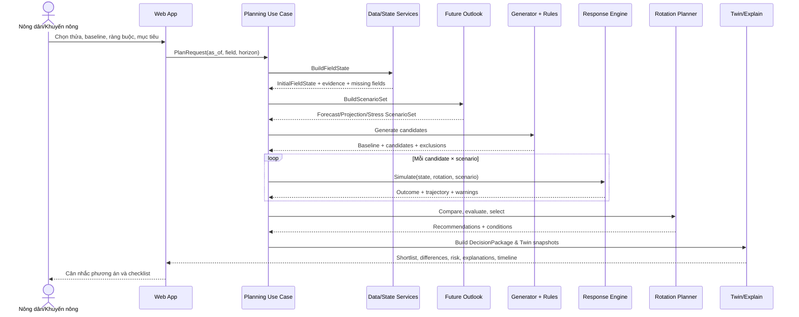

# FIELDSHIFT-MEKONG — SOFTWARE SOLUTION DESIGN

**Phiên bản:** 2.0 · **Ngày:** 12/11/2026 · **Trạng thái:** Product/Software Solution — định hướng triển khai, **chưa** xác nhận độ chính xác dự báo và mô hình nông học.  
**Phạm vi:** ĐBSCL, ưu tiên hệ thống lúa–màu. **Độc giả:** Product Owner, kỹ sư phần mềm, kỹ sư dữ liệu, kỹ sư mô hình, UX và chuyên gia nông học.  
**Nguồn cơ sở:** Problem Statement `Field_Shift_Problem_Statement(2).md`; thiết kế v1 `FieldShift-Mekong — Bản thiết kế giải pháp.docx`; ghi chú nghiên cứu `FieldShift_CARP_Research_2026.md`; đề chính thức NASA Space Apps 2026 — *Field Shift: Adapting Farms with NASA Data*.

> **Một câu định nghĩa sản phẩm:** FieldShift giúp nông dân và cán bộ khuyến nông xác định **những chiến lược luân canh khả thi cho các vụ sắp tới**, đối chiếu chúng với cách trồng hiện tại dưới những điều kiện khí hậu/nước khác nhau, và hiểu **lợi ích, rủi ro, tác động tiềm năng lên đất, điều kiện áp dụng và điều còn phải kiểm chứng**.  
> **Quy tắc không đổi:** **Planning Engine là lõi quyết định; Digital Twin là lớp mô phỏng/hiển thị để kiểm tra và giải thích.** Dự báo khí hậu là đầu vào hỗ trợ quyết định, **không** phải mục tiêu độc lập của sản phẩm.

---

## 0. Quy ước đọc và ranh giới tài liệu

- Tài liệu này là **Solution Specification**: nêu sản phẩm phải làm gì, module tương tác thế nào, logic nghiệp vụ, hợp đồng dữ liệu và điều kiện hoàn thành. **Không** khóa framework, cloud, database, thư viện hay thuật toán ML cụ thể.
- **MUST**: yêu cầu bắt buộc đối với triển khai; **SHOULD**: ưu tiên cao; **MAY**: tùy chọn/nâng cấp.
- **MVP**: phiên bản đầu phải chứng minh được end-to-end *dữ liệu → phương án luân canh → so sánh → giải thích*, không phải toàn bộ độ chính xác mà một hệ nông học vận hành thực tế đòi hỏi.
- **Không được hiểu** các ví dụ, số ngày, các tình huống và chỉ báo minh họa trong tài liệu là kết quả dự báo thực địa.
- Mọi thay đổi ảnh hưởng nguyên tắc an toàn, bằng chứng và phạm vi quyết định phải được review bởi PO và đại diện nông học; thay đổi mô hình khoa học phải có kiểm định tương ứng.

## 1. Problem–Solution Fit: khóa bài toán, tránh drift

### 1.1. Bài toán NASA giao

Đề chính thức yêu cầu **công cụ hỗ trợ quyết định** kết hợp quan sát Trái Đất NASA với **thông tin đất địa phương, đặc tính cây trồng và ưu tiên người nông dân** để họ **khám phá các chiến lược luân canh** có tiềm năng hỗ trợ sức khỏe đất và tăng khả năng thích ứng với biến động khí hậu/nước.

**NASA không bắt buộc**: dự báo thời tiết bằng AI, xác định đúng một chuỗi tối ưu, Digital Twin 3D, ML/RL hay giải pháp tối ưu toán học nhất định. Những kỹ thuật này chỉ hợp lệ khi phục vụ mục tiêu quyết định nói trên.

### 1.2. Job-to-be-done chính

> “Tôi đang trồng theo chuỗi A. Với điều kiện thửa ruộng và khả năng đầu tư của mình, những chuỗi B/C nào tôi **có thể** thực hiện trong các vụ tới? Khi nước, mưa, nhiệt hoặc mặn diễn biến bất lợi, chúng thay đổi hiệu quả thế nào? Phương án nào đáng cân nhắc, **vì sao**, và tôi phải kiểm tra gì trước khi làm thật?”

Đầu ra **không** phải `crop_label`, bản đồ NDVI, đồ thị thời tiết hoặc video cây mọc. Đầu ra là **Decision Package** gồm tập phương án, điều kiện khả thi, bằng chứng, đánh đổi, mức bất định, kế hoạch dự phòng và các bước cần xác minh.

### 1.3. Truy vết yêu cầu → giải pháp → kết quả kiểm tra

| ID | Nhu cầu gốc | Năng lực đảm nhận | Bằng chứng nghiệm thu |
|---|---|---|---|
| PS-01 | Kết hợp dữ liệu NASA | Data Adapters + Context Builder | Mỗi phương án truy vết được biến NASA đã ảnh hưởng đến đánh giá nào |
| PS-02 | Có đất, cây, nông dân | Field Profile + Crop Catalog + Constraints | Đổi điều kiện đất/nguồn lực làm thay đổi tính khả thi hoặc mức cảnh báo đúng lý do |
| PS-03 | **Chuỗi** luân canh nhiều mùa | Rotation Generator + State Transition | Hai chuỗi khác thứ tự có thể cho kết quả khác nếu có cơ chế liên vụ được hỗ trợ |
| PS-04 | Sức khỏe đất | Soil Impact Assessment | Có phân biệt tác động mô phỏng định lượng và *lợi ích tiềm năng* định tính |
| PS-05 | Thích ứng thời tiết/nước | Future Outlook + Scenario Evaluation | So sánh cùng một chuỗi ở nhiều điều kiện tương lai; nêu được điểm dễ tổn thương |
| PS-06 | Phù hợp ưu tiên nông dân | Risk-aware Planner | Đổi ưu tiên/ràng buộc có thể đổi shortlist; không đưa phương án bất khả thi làm khuyến nghị chính |
| PS-07 | Dễ hiểu, dùng được | Twin Viewer + Explanation + Action Checklist | Người dùng biết chuỗi nào, vào vụ nào, đổi được gì, còn phải kiểm tra gì |
| PS-08 | Minh bạch | Evidence/Uncertainty Contract | Mọi khẳng định có nguồn, thời gian, quy mô, phương pháp, giới hạn và trạng thái biết/chưa biết |

### 1.4. Phân biệt bốn năng lực — tránh dùng từ “dự đoán” cho mọi việc

| Năng lực | Câu hỏi | Thành phần |
|---|---|---|
| **Observation/Estimation** | Hiện tại thửa ruộng và vùng xung quanh ra sao? | Field State Estimator |
| **Forecast/Projection/Scenario** | Tương lai có những điều kiện nào khả dĩ hoặc cần kiểm tra? | Future Outlook Engine |
| **Outcome Prediction** | **Nếu chọn chuỗi X**, hệ quả theo giả định và mô hình có thể thế nào? | Crop–Soil Response Engine |
| **Planning/Recommendation** | Với rủi ro, giới hạn và ưu tiên hiện có, nên cân nhắc những chuỗi nào? | Rotation Planning Engine |

**Không** đánh đồng dự báo khí hậu với khuyến nghị cây. **Không** đánh đồng mô phỏng với sự thật chắc chắn trong tương lai.

## 2. Phạm vi sản phẩm và đối tượng sử dụng

### 2.1. Người dùng

- **Chính:** nông hộ, cán bộ khuyến nông, thành viên hợp tác xã; MVP ưu tiên cán bộ khuyến nông/HTX thao tác cùng nông dân.
- **Phụ:** quản trị dữ liệu vùng, chuyên gia kiểm định thông số cây và luật.
- **Không phải đối tượng chính:** nhà nghiên cứu cần công cụ huấn luyện mô hình chuyên sâu hoặc hệ giám sát nông nghiệp cấp quốc gia.

### 2.2. Ranh giới địa lý và nghiệp vụ

- **MVP:** một số địa điểm ĐBSCL có bối cảnh nước/mặn khác nhau. **Danh mục ứng viên ban đầu kế thừa Solution v1:** lúa, ngô, đậu nành, đậu xanh, mè, đậu phộng, dưa hấu; chỉ kích hoạt cây/giống nào có đủ tham số và căn cứ địa phương. Ba cửa sổ vụ/năm là **cấu hình vùng**, không phải định luật bắt mọi ruộng phải trồng 3 vụ.
- **Tầm nhìn quyết định:** kế hoạch cho vụ tới và **3 vụ tiếp theo** là phạm vi bắt buộc của MVP; xem xét 1–3 năm ở dạng kịch bản/rolling plan, không hứa dự báo ngày cụ thể xa nhiều năm.
- **Các hành động hợp lệ:** giữ nguyên cây; thay cây; điều chỉnh ngày gieo; thay cách tưới/quản lý tàn dư khi đủ dữ liệu; nghỉ đất/cây che phủ nếu phù hợp vùng.
- **Mở rộng:** thêm vùng, cây, kiểu mùa vụ, mô hình đất sâu hơn, nhiều thửa và tối ưu đa nông hộ. Phải thực hiện bằng cấu hình và adapter, không gắn cứng logic ĐBSCL vào domain core.

### 2.3. Ngoài phạm vi MVP

- Dự báo chắc chắn mưa từng ngày của năm 2027–2029; dự báo chính xác mặn tại một kênh khi không có dữ liệu thủy văn tương ứng.
- Dự báo SOC/NPK, sâu bệnh hoặc năng suất tuyệt đối chính xác khi chưa có mô hình đã hiệu chỉnh và quan trắc.
- Tự động đặt hàng vật tư, giao dịch nông sản, điều khiển tưới, ra quyết định thay nông dân.
- Xây dựng chatbot làm engine; huấn luyện mô hình Deep Learning từ dữ liệu không có nhãn “chuỗi tối ưu”.
- Sản phẩm chỉ trình diễn NASA trên bản đồ mà không đưa ra được phương án luân canh có điều kiện.

## 3. Các khái niệm domain thống nhất

| Thuật ngữ | Định nghĩa có thể dùng khi lập trình |
|---|---|
| **Field** | Thửa có hình học/vị trí, diện tích, nguồn nước, đất, lịch sử và người quản lý. |
| **FieldProfile** | Thông tin đầu vào do người dùng và nguồn công khai cung cấp, bao gồm giá trị **chưa biết**. |
| **FieldState** | Ước lượng trạng thái ruộng **ở thời điểm quyết định**, có giá trị và mức bất định, không chỉ metadata. |
| **Crop** | Loài cây và các đặc tính tham khảo; **CropVariant** là giống/nhóm giống nếu có thông số riêng. |
| **SeasonWindow** | Khung lịch gieo–thu hoạch được cấu hình theo vùng và hệ thống nước. |
| **RotationAction** | Cây/giống (hoặc nghỉ đất), thời gian gieo và thực hành quản lý trong một vụ. |
| **RotationSequence** | Dãy hành động dự kiến cho các vụ, có thể là chuỗi cố định. |
| **AdaptiveRotationPolicy** | Quy tắc **có điều kiện**: ở đầu vụ sau, chọn hành động căn cứ trạng thái/rủi ro vừa cập nhật. |
| **Baseline** | Chuỗi canh tác đang thực hiện hoặc dự định tiếp tục; luôn được đánh giá trên cùng kịch bản với phương án mới. |
| **Outlook** | Thông tin tương lai có gắn loại: forecast, climate projection, climatology hoặc stress scenario. |
| **Scenario** | Một quỹ đạo điều kiện môi trường và nước giả định/được dự báo cho horizon cụ thể. |
| **Outcome** | Kết quả **ước lượng** của một phương án trong một kịch bản: nước, stress, năng suất khi đủ cơ sở, tiền khi đủ tham số. |
| **Recommendation** | Phương án đáng **cân nhắc**, không phải lệnh sản xuất; có điều kiện áp dụng và cảnh báo. |
| **DecisionPackage** | Bản kết quả có baseline, shortlist, so sánh, nguồn chứng cứ, kịch bản, việc cần kiểm tra, bản chụp mô phỏng. |
| **DigitalTwinView** | Góc nhìn tương tác từ trạng thái và outcome đã tính; **không** tự là nguồn sự thật hoặc tự sinh chỉ số. |

**Nguyên tắc quan trọng:** `FieldProfile` ≠ `FieldState`; `Scenario` ≠ `Forecast`; `RotationSequence` ≠ `Recommendation`; `DigitalTwinView` ≠ `Prediction Engine`.

## 4. Luồng trải nghiệm sản phẩm (end-to-end)

### 4.1. Journey chuẩn

1. **Chọn thửa:** chấm điểm/vẽ thửa trên bản đồ hoặc chọn thửa lưu sẵn.
2. **Xác nhận tình trạng:** chuỗi đang trồng, nguồn nước, khả năng tưới/thoát, đất phèn/mặn nếu biết, các ràng buộc cứng, ưu tiên.
3. **Hệ thống tự xây hồ sơ:** lấy dữ liệu NASA và nguồn đất; hiển thị đã đo/ước lượng/chưa biết; yêu cầu người dùng xác nhận những biến then chốt khi cần.
4. **Chọn chân trời:** vụ tới/3 vụ tới; cho biết chế độ dự báo sẵn có hoặc chỉ là kịch bản.
5. **Nhận shortlist:** baseline + 2–4 phương án đáng cân nhắc, có lịch gieo, tính khả thi, rủi ro và điều kiện áp dụng.
6. **So sánh:** xem khác biệt nước, stress, lợi ích tiềm năng cho đất, độ phù hợp nguồn lực và kinh tế nếu có dữ liệu.
7. **Khám phá bằng Twin:** chọn một phương án, chọn một kịch bản; xem tiến trình theo vụ và chỉ số chính cập nhật cùng một mô hình.
8. **What-if:** thay ngày gieo, giả định mặn đến sớm, nguồn nước ít hơn, hoặc ưu tiên; engine tính lại **phần phụ thuộc thay đổi**, đánh dấu nếu là giả định do người dùng đặt.
9. **Ra quyết định có điều kiện:** lưu phương án, nhận checklist đo đạc/trao đổi với cán bộ khuyến nông; **không** thay chuyên gia.
10. **Sau mỗi vụ:** cập nhật quan trắc, đóng vụ, tái lập kế hoạch cho các vụ còn lại.

### 4.2. Các use case bắt buộc

| UC | Tình huống | Hệ thống phải làm |
|---|---|---|
| UC-01 | Hộ giữ 3 vụ lúa, muốn giảm phụ thuộc nước | Giữ baseline; đề xuất chuỗi thay tối đa 1 vụ nếu khả thi, có giải thích chênh lệch |
| UC-02 | Đất khó thoát nước, người dùng chọn cây cạn | Cảnh báo hoặc loại khi có chứng cứ bất khả thi; nêu điều kiện cần cải tạo/kiểm tra |
| UC-03 | Chưa có EC nước kênh ở vùng mặn | Không gán EC giả làm số đo; báo rủi ro/điều kiện và yêu cầu đo trước khi chốt |
| UC-04 | Có tín hiệu mùa khô cao | So sánh baseline và lựa chọn thay thế trong các kịch bản khô, không tự hứa hạn sẽ xảy ra |
| UC-05 | Muốn cải thiện đất | Nêu cơ chế giả định (che phủ, họ đậu, tàn dư), giới hạn và lợi ích tiềm năng |
| UC-06 | Thời điểm gieo muộn | Không chọn chuỗi nếu thời gian sinh trưởng/lịch vụ xung đột; cho thử thời điểm khác |
| UC-07 | Ngân sách hoặc máy móc hạn chế | Khuyến nghị phải thỏa ràng buộc đã xác nhận |
| UC-08 | Sau vụ 1 thực tế khác dự kiến | Cập nhật state và tính lại quyết định từ vụ 2, không xem kế hoạch cũ là bất biến |
| UC-09 | Dữ liệu NASA hoặc dự báo tạm không truy cập được | Dùng bản cache hợp lệ nếu còn phù hợp; nêu nguồn và độ mới; giảm mức khẳng định |

## 5. Kiến trúc hệ thống: Layered + Hexagonal, domain-centered

### 5.1. Sơ đồ lớp và module



*Mũi tên là quan hệ phối hợp/ phụ thuộc logic, không phải thứ tự gọi cứng từng dòng trong mọi request. Ở triển khai, Application Orchestrator điều phối các module và các module chỉ phụ thuộc **port** được định nghĩa tại domain/application boundary.*

### 5.2. Trách nhiệm các layer

| Layer | Chứa gì | Không được chứa gì |
|---|---|---|
| **L1 Presentation** | Form thửa, lịch vụ, chọn phương án, Twin, so sánh, cảnh báo | Logic dự báo, công thức, quyết định cây dựa trên UI |
| **L2 Application** | Các use case, orchestration, workflow, authorization, transaction/snapshot | Công thức nông học hoặc quy tắc đất đặt rải rác trong controller |
| **L3 Domain & Decision** | Entity/value object, luật khả thi, generator, evaluation, planner, policy | API client NASA, truy vấn database, thư viện UI |
| **L4 Ports** | Hợp đồng nạp dữ liệu, dự báo, mô hình và persistence | Implementation phụ thuộc nhà cung cấp cụ thể |
| **L5 Infrastructure** | Adapter NASA/FAO/local, kho dữ liệu, cache, job, tính toán | Quyết định sản phẩm ẩn trong adapter |
| **Cross-cutting** | Evidence, schema/units, quyền truy cập, kiểm định, observability, model registry | Cơ chế “tin tưởng ngầm” vào giá trị thiếu nguồn |

**Khuyến nghị triển khai:** **Modular Monolith** trước; các module có contract độc lập. Không cần tách microservices chỉ để đạt vẻ phức tạp. Có thể chuyển những tác vụ dự báo/mô phỏng nặng sang background jobs **nội bộ hệ thống**; đây là hành vi ứng dụng khi vận hành, không phải yêu cầu làm việc bất đồng bộ của nhóm phát triển.

## 6. Các subsystem và hợp đồng chức năng

### 6.1. Data Integration & Context Builder

**Mục đích:** chuyển dữ liệu khác nguồn/độ phân giải/chu kỳ thành `FieldContext` có thể dùng được, không giả vờ mọi dữ liệu là đo tại thửa.

**Đầu vào:** geometry, ngày ra quyết định `as_of`, loại biến, nguồn và lịch sử thửa.  
**Đầu ra:** `FieldContext` với các thành phần: `climate_history`, `regional_soil_moisture`, `terrain_features`, `vegetation_history`, `local_soil`, `water_supply`, `management_history`, `data_coverage`, `evidence`.

**MUST:**
- Có adapter riêng cho từng nguồn, chuẩn hóa tên biến, đơn vị, múi giờ và calendar; lưu metadata độ phân giải **gốc** và thời điểm cập nhật.
- Cho phép các nguồn **không đồng thời bắt đầu/kết thúc**; không tuyên bố “35 năm có đầy đủ mọi nguồn”.
- Dữ liệu lưới quy mô vùng chỉ là `regional_context` nếu không có downscaling/validation phù hợp.
- Các giá trị không có = `unknown`, không tự thay bằng trung bình rồi trình bày như đã đo.
- Truy vết được quan hệ feature → dataset/version/time window → source.

**Không làm:** chọn cây, quyết định thứ tự vụ, tự suy EC nước kênh từ mưa hoặc suy sức khỏe đất trực tiếp từ NDVI.

### 6.2. Field State Estimator

**Mục đích:** biến `FieldProfile + FieldContext` thành `InitialFieldState` tại `as_of`.

**Tối thiểu:** trạng thái nước/vùng rễ theo mức dữ liệu cho phép, đặc tính đất nền, bằng chứng/độ bất định về mặn, khả năng thoát nước, crop history, hiện trạng tàn dư, khả năng tưới, vốn/nguồn lực. Các biến chưa có phép đo sẽ giữ dạng dải giả định hoặc `unknown`.

**MUST:** phân biệt `measured_at_field`, `reported_by_farmer`, `estimated_from_regional_data`, `inferred_by_model`, `assumed_scenario`.

**Đầu ra ví dụ:** không phải “độ mặn ruộng = 4.0” từ vệ tinh; mà là “EC tại ruộng **chưa biết**; vùng có rủi ro mặn theo bản tin; phải đo ECw/đánh giá ECe nếu quyết định nhạy với mặn”.

**Chính sách cập nhật:** phép đo mới không chỉ ghi đè bừa lên toàn bộ state. Phải lưu timestamp, đơn vị, vị trí đo và độ liên quan; state mới được lập thành snapshot, state cũ bảo toàn phục vụ truy vết.

### 6.3. Future Outlook & Scenario Engine

**Mục đích:** tạo một tập điều kiện tương lai có căn cứ, được **phân loại đúng**.

| Horizon | Nguồn và chế độ | Cách sử dụng |
|---|---|---|
| Vụ gần nhất, vài ngày–tuần | Dự báo thời tiết khi khả dụng | Những ngưỡng cấp tính, ngày gieo sát hiện tại |
| Những tháng tới | Dự báo mùa/tổ hợp **nếu truy cập được và đã đánh giá skill**; lịch sử NASA là bối cảnh và hiệu chỉnh | Chuyển thành phân bố/kịch bản nhiệt, mưa, đợt khô phù hợp chân trời |
| 1–3 năm | NASA POWER Projection API/NEX-GDDP-CMIP6, climatology, stress testing | Khảo sát khả năng chống chịu; **không** hứa ngày mưa hoặc độ mặn cụ thể |
| Mặn/nước ĐBSCL | Bản tin/quan trắc địa phương, thủy văn và EC đo tại ruộng nếu có | Nhánh rủi ro **riêng**; không suy trực tiếp từ NASA POWER/IMERG |

**Đầu ra bắt buộc:** `ScenarioSet` gồm `scenarios`, `time_horizon`, `scenario_kind`, `variables`, `source`, `issue_time`, `as_of`, `probability_semantics`, `quality_flags`, `assumptions`.

**Phân loại có tính cưỡng chế:**

- `FORECAST`: dự báo thật có ngày phát hành, chân trời và nguồn; chỉ được mô tả phân vị/xác suất đã được hiệu chỉnh phù hợp.
- `CLIMATE_PROJECTION`: quỹ đạo theo mô hình và SSP; **không** gán xác suất xảy ra cho SSP nếu không có cơ sở.
- `CLIMATOLOGY`: nền thống kê quá khứ, dùng làm fallback/đối chứng.
- `STRESS_TEST`: tình huống what-if (mưa giảm, mặn sớm) **do người dùng/nhà thiết kế định nghĩa**, không gọi là dự báo.

**MUST:**
- Hệ thống không tự sinh một timeline 2027 “chắc chắn” bằng cách sao chép một năm cũ.
- Khi thiếu nguồn forecast, vẫn tạo bộ **kịch bản** hợp lệ nhưng nêu rõ “không có dự báo mùa được kiểm chứng”.
- Giữ tương quan và thứ tự thời gian quan trọng (mưa liên tiếp/ngày khô, nhiệt, ET) trong bộ sinh weather scenarios; không đảo ngẫu nhiên các ngày rồi coi là khí tượng thật.
- Không trộn xác suất dự báo đã hiệu chỉnh với kịch bản stress test tùy ý để tính một xác suất thất bại giả tạo.
- Phải nêu khi nào kịch bản mặn là giả định thay vì được một nguồn thủy văn hỗ trợ.

### 6.4. Crop Knowledge & Feasibility Engine

**Mục đích:** đảm bảo tính khả thi nông học và nguồn lực **trước khi** mô phỏng/tối ưu.

**Crop Catalog** chứa: loài/giống; vùng/lịch trồng; thời gian sinh trưởng; nhu cầu nhiệt/nước; các ngưỡng hoặc đáp ứng stress; điều kiện đất; giai đoạn nhạy cảm; tàn dư và đặc điểm nông học; giới hạn tri thức; nguồn trích dẫn và version.

**Specification Rules** được chia:

1. `HARD`: bất khả thi đã xác định chắc chắn (ví dụ ngày thu hoạch chắc chắn vượt cửa sổ cho vụ sau; không có giống/thiết bị bắt buộc).
2. `SOFT`: rủi ro hoặc đánh đổi có thể chấp nhận tùy người dùng (ví dụ stress làm giảm năng suất).
3. `UNKNOWN_REQUIRES_CHECK`: cần đo/khảo sát mới quyết định được (ví dụ EC, phèn/thoát nước chưa xác nhận).

**Lưu ý mặn:** ECw của nước tưới ≠ ECe đất vùng rễ. Ngưỡng bắt đầu giảm năng suất **không tự động** là ngưỡng cấm trồng; phải dựa điều kiện, dữ liệu và mức mất mát chấp nhận được. NASADEM không tự chứng minh ruộng ngập vì còn phụ thuộc đê bao/cống/thoát nước.

**MUST:** mọi lý do loại/cảnh báo phải có `rule_id`, `reason`, `severity`, `evidence`, `inputs_used`, `how_to_resolve`.

### 6.5. Rotation Candidate Generator

**Mục đích:** tự xây dựng các lựa chọn có cấu trúc thay vì chỉ cho người dùng nhập sẵn vài chuỗi.

**Đầu vào:** `InitialFieldState`, `CropCatalog`, `SeasonWindows`, `FarmerConstraints`, `Horizon`.

**Đầu ra:** `CandidateSet`: baseline + các chuỗi/policy khả thi hoặc có điều kiện + bản ghi lý do bị loại.

**Thuật toán nghiệp vụ:**

1. Xây tập hành động khả dĩ theo từng cửa sổ vụ, gồm cây, nhóm ngày gieo, phương pháp quản lý và nghỉ đất (nếu cấu hình).
2. Kết hợp thành chuỗi theo horizon; kiểm tra tính liên tục, lịch vụ và nguồn lực; giữ riêng những trường hợp cần xác minh.
3. Dùng điều kiện vụ trước để loại/cảnh báo vụ sau nếu đã có cơ chế nông học thích hợp.
4. **Bắt buộc đưa baseline vào tập đánh giá** kể cả khi baseline có cảnh báo; ghi rõ trạng thái thay vì che giấu.
5. Với 3 vụ, có thể enumerate sau khi giới hạn số action; với 1–3 năm, dùng tìm kiếm có cắt tỉa/rolling horizon, **không** tự tuyên bố tìm được tối ưu toàn cục nếu chưa có chứng minh.
6. Đảm bảo shortlist không gồm nhiều biến thể gần như trùng nhau chỉ để lấp số lượng.

**Không làm:** tự suy rằng cây họ đậu luôn tốt hơn lúa; loại cây theo một ngưỡng EC thiếu ngữ cảnh; chọn chuỗi cuối cùng trước khi đánh giá outcome.

### 6.6. Crop–Soil Response Engine — phần dự đoán hệ quả

**Mục đích:** với một candidate `a` và kịch bản `w`, ước lượng tiến trình `state` và `outcome` qua vụ.

Quan hệ logic:

\[
 s_{t+1}^{(j)}=f(s_t^{(j)},a_t,w_t^{(j)};\theta), \qquad
 y_t^{(j)}=g(s_t^{(j)},a_t,w_t^{(j)};\theta)
\]

- `s`: nước, muối (nếu đủ dữ liệu), các trạng thái đất có cơ chế hợp lệ, lịch sử canh tác.
- `a`: cây, thời vụ, tưới, tàn dư và các thực hành được mô hình hỗ trợ.
- `w`: thời tiết/nước/mặn của kịch bản; `θ`: tham số mô hình có version và nguồn.

**Hợp đồng bắt buộc:** `simulate(initial_state, rotation, scenario, model_config) -> Trajectory + Outcome + Evidence + Warnings`.

**Các nhánh độc lập và lắp ghép được:**

| Model Port | Chức năng | Điều kiện đủ tin cậy ở MVP |
|---|---|---|
| `WaterBalanceModel` | Mưa, ET, nước vùng rễ, nhu cầu tưới, stress nước | Phương trình và giả định kiểm tra được; riêng ruộng lúa xử lý nước mặt/thấm theo mô hình có căn cứ |
| `CropResponseModel` | Sinh trưởng/yield response trong điều kiện nhiệt, nước, mặn | Chỉ tính yield tuyệt đối nếu có tham số, calibration/validation; nếu chưa, trả relative stress/risk |
| `SalinityModel` | Tác động mặn hoặc động học muối khi đủ biến | Khi không biết ECw/ECe, trả conditional exposure/risk; **không** bịa ECe |
| `SoilImpactModel` | Che phủ, tàn dư, đa dạng cây và thay đổi đất nhiều vụ | Nếu chỉ có rule thì trả **potential indicator**, không trả “SOC tăng x%” |
| `EconomicModel` | Chi phí, sản lượng và biến thiên giá | Chỉ bật khi có dữ liệu giá/chi phí, công khai giả định và thời điểm |

**Chuỗi liên vụ:** nếu mô hình cho phép, trạng thái nước/chất hữu cơ/dinh dưỡng/tàn dư của cuối vụ **được truyền thật** sang vụ sau. Nếu chỉ có qualitative indicators, sản phẩm phải ghi rõ “tác động tiềm năng”, không xem đó là state vật lý được cập nhật.

**Nguyên tắc khoa học:** không lấy tích các hệ số ảnh hưởng nước và mặn để khẳng định yield chính xác nếu chưa biết mô hình có cho phép kết hợp đó không. Không cộng nhiều chỉ báo stress trùng nguyên nhân hai lần.

### 6.7. Risk-Aware Rotation Planning Engine — lõi sản phẩm

**Mục đích:** từ các outcome đã đánh giá, chọn **những chiến lược đáng cân nhắc**, không tự chọn một “sự thật tối ưu”.

**Đầu vào:** `CandidateSet`, `SimulationResultSet`, `FarmerPriorities`, `RiskLimits`, `EvidenceQuality`.

**Đầu ra:** `RecommendationSet` với baseline, 2–4 phương án thay thế (nếu đủ điều kiện), trade-offs, robustness, điều kiện chuyển phương án, warnings.

**Quy trình:**

1. Loại ứng viên vi phạm `HARD` với bằng chứng đủ mạnh; ứng viên thiếu thông tin giữ trạng thái `CONDITIONAL`, **không** trở thành khuyến nghị chắc chắn.
2. Tính các tiêu chí trên **cùng bộ scenario** cho baseline và ứng viên: nước, ngày stress, chỉ số phù hợp đất, yield/lợi nhuận **nếu hợp lệ**, mức tổn thất trong tình huống xấu, chi phí chuyển đổi.
3. Đánh giá hiệu quả theo từng mục tiêu và các *trade-offs*; giữ Pareto front hoặc tập không bị trội.
4. Dùng ưu tiên nông hộ để **xếp thứ tự cách trình bày/kiểm tra ràng buộc**, không đánh lừa người dùng bằng một “điểm khoa học tuyệt đối”.
5. Đánh giá `robustness`: kết quả có đảo khi mưa thấp, mặn sớm, giá giảm hoặc thay đổi tham số không? Chỉ gọi là **xác suất** nếu phân bố scenario có ý nghĩa xác suất được hiệu chỉnh.
6. Đa dạng hóa 2–4 đề xuất theo chiến lược (tiết kiệm nước, giảm rủi ro, hỗ trợ đất, cân bằng thu nhập); nếu không đủ ứng viên hợp lệ, trả ít hơn và giải thích.
7. Gắn **trigger condition** cho phương án thích ứng: “nếu trước vụ 2 đo ECw vượt ngưỡng đánh giá thì không thực hiện phương án X; tái lập kế hoạch”. Trigger phải là điều kiện có đơn vị/nguồn đo/cách xác minh, không phải lời khuyên mơ hồ.

**Tình trạng quyết định:** `RECOMMEND_FOR_CONSIDERATION`, `CONDITIONAL_PENDING_CHECK`, `NOT_FEASIBLE`, `INSUFFICIENT_EVIDENCE`. Các trạng thái này phải đi xuyên từ domain đến UI.

### 6.8. Decision Explanation & Action Checklist

**Mục đích:** dịch output thành câu trả lời cho nông dân.

Mỗi recommendation **MUST** trả lời:

- **Chuỗi nào?** cây/giống, tháng hoặc khung gieo, hành động theo vụ.
- **Vì sao?** hai hoặc ba nguyên nhân chính có nguồn (ví dụ thiếu nước ở vụ giữa; lịch phơi đất; thay đổi số vụ lúa).
- **So với hiện trạng được/mất gì?** chỉ số và đơn vị khi đủ dữ liệu; nếu không thì mô tả định tính có điều kiện.
- **Rủi ro lớn nhất?** những scenario hoặc yếu tố chưa biết có thể làm đảo quyết định.
- **Điều kiện áp dụng?** nguồn tưới, thoát nước, vốn, giống, lịch vụ, thị trường.
- **Cần kiểm tra gì trước khi xuống giống?** hành động cụ thể, không quá tải.

**LLM** nếu dùng chỉ diễn giải dữ liệu cấu trúc đã qua kiểm duyệt; **không** tự sinh kết quả mô phỏng, ngưỡng, nguồn bằng chứng hoặc recommendation khác engine.

## 7. Data Architecture — mỗi nguồn có vai trò đúng

### 7.1. Source-to-feature map

| Nguồn | Dữ liệu sử dụng | Vai trò | Điều tuyệt đối không suy ra trực tiếp |
|---|---|---|---|
| **NASA POWER Daily** | Nhiệt, ẩm, gió, bức xạ, các biến khả dụng | Historical climate, ET₀, mùa vụ, climate normals | Dự báo chính xác ngày mưa trong tương lai |
| **NASA GPM IMERG** | Ước lượng mưa theo thời gian | Phân bố mưa, ngày khô, mưa cực đoan; đối chiếu | Mưa chính xác trên từng thửa |
| **NASA SMAP L4** | Độ ẩm đất mặt/vùng rễ quy mô vùng | Regional moisture state và anomaly | % ẩm tại một luống hoặc tầng đất đo trực tiếp |
| **NASA Landsat/HLS** | Phản xạ/NDVI/EVI/che phủ | Phát hiện giai đoạn che phủ, có thể hỗ trợ lịch vụ | NPK, sức khỏe đất hoặc loại cây chắc chắn |
| **NASADEM/SRTM** | Độ cao, địa hình | Bối cảnh thoát nước/xói mòn theo địa hình | Tình trạng ngập nội đồng khi thiếu dữ liệu thủy lợi |
| **NASA POWER Projection API** | CMIP6 downscaled theo ngày/tháng | Climate **projection** nhiều năm | Dự báo thời tiết ngày cụ thể năm 2027 |
| **NASA GEOS-S2S / nguồn S2S khác** | Dự báo tổ hợp khi có quyền truy cập | Seasonal/subseasonal **forecast** | Dữ liệu chắc chắn có API cho mọi vị trí hoặc forecast chính xác cấp thửa |
| **SoilGrids** *(ngoài NASA)* | pH, texture, carbon... theo sản phẩm | Prior về thuộc tính đất và độ bất định | Kết quả xét nghiệm thửa |
| **FAO/khuyến nông** *(ngoài NASA)* | Đặc tính cây/giống, lịch mùa, phản ứng với stress | Crop catalog, models, rules | Chân lý áp dụng nguyên xi cho mọi giống/địa phương |
| **Địa phương/MRC/quan trắc** | Mặn nước, dòng chảy, lịch cấp nước, cảnh báo | Water/salinity constraints và scenarios | Trạng thái EC ở kênh/thửa không có điểm đo tương ứng |
| **Người dùng** | EC, pH, lịch sử, thiết bị, giá, vốn | Ground truth cục bộ hoặc khai báo | Mọi khai báo đều chính xác nếu chưa kiểm chứng |

**Lưu ý:** ngày bắt đầu của POWER, GPM, SMAP, HLS khác nhau; module tự tính coverage. NASA POWER Projection API cung cấp **climate projection** 2015–2100 theo tài liệu dịch vụ hiện hành, không được lấy nhãn `projection` rồi trình bày như dự báo mùa có xác suất. **Tại thời điểm 12/11/2026**, danh mục Resources riêng của thử thách được đơn vị tổ chức địa phương thông báo sẽ công bố **13/11/2026**; không giả định nó đã có hoặc đã được tích hợp.

### 7.2. Các loại dữ liệu cốt lõi

1. **Spatial Reference:** field geometry, centroid, grid-cell footprint, `scale = field|regional|basin`, CRS/độ chính xác.
2. **Temporal Reference:** `observed_at`, `available_at`, `issue_time`, `valid_from/to`, `as_of`; không sử dụng dữ liệu được công bố **sau** ngày đánh giá khi chạy historical hindcast.
3. **Variable:** tên, giá trị/dải, đơn vị, missing state, nguồn, phương pháp ước lượng.
4. **Evidence:** `OBSERVED_FIELD`, `OBSERVED_REMOTE_ESTIMATE`, `MODEL_ESTIMATE`, `FORECAST`, `PROJECTION`, `ASSUMPTION`, `LITERATURE_RULE`; có thể cần nhiều tags cho một kết luận.
5. **Quality:** độ phủ, độ mới, nguồn chồng lấp, khả năng hiệu chỉnh và limitation.
6. **Configuration:** RegionProfile, crop versions, model versions, thresholds, scenario design.

### 7.3. Nguyên tắc dùng dữ liệu và fallback

- **Không có dữ liệu NASA:** không được giả vờ kết hợp NASA; báo tính năng nào bị tạm dừng và dùng cache có thời gian rõ ràng nếu còn hợp lệ.
- **Không có seasonal forecast:** vẫn lập kế hoạch bằng climatology + climate scenarios, **không** nói “hệ thống dự báo 2027”.
- **Không có EC:** không gán “đất an toàn”; phân loại recommendation nhạy với mặn là có điều kiện, gắn việc cần đo.
- **Không có giá/chi phí:** ẩn kết luận lợi nhuận; có thể vẫn đánh giá nước, lịch vụ và tính khả thi.
- **Không có thông số đất đủ tin:** hạn chế claim về năng suất/đất; ưu tiên hỏi thêm thông tin người dùng.
- **Nguồn xung đột:** lưu cả hai, áp dụng precedence đã cấu hình theo biến/thời gian/quy mô; giải thích điều được chọn, không âm thầm ghi đè.

## 8. Sequence Diagram — đường đi của một request



**Chú ý:** UI không gọi trực tiếp mô hình cây để lấy kết quả mới nằm ngoài `DecisionPackage`. Nếu người dùng thay kịch bản, use case phải tạo scenario snapshot mới, tái dùng các dữ liệu không đổi và ghi lại version.

## 9. Hợp đồng dữ liệu (conceptual contracts)

Hợp đồng dưới đây ở mức semantics; cách hiện thực REST/GraphQL/event, object schema hay protobuf do nhóm quyết định sau. Tên khóa và trạng thái được giữ nhất quán giữa các module.

### 9.1. PlanRequest

```json
{
  "request_id": "req-example",
  "as_of": "2026-11-12",
  "field_id": "field-example",
  "horizon": { "seasons": 3 },
  "baseline_id": "rice-rice-rice",
  "farmer_priorities": ["avoid_crop_failure", "save_water", "soil_health"],
  "hard_constraints": {
    "no_new_machinery": true,
    "budget_limit": null,
    "available_irrigation": "reported_limited"
  },
  "requested_outlook_modes": ["FORECAST", "STRESS_TEST"],
  "information_state": { "canal_ecw": "UNKNOWN" }
}
```

### 9.2. Scenario (mẫu)

```json
{
  "scenario_id": "dry-outlook-example",
  "kind": "STRESS_TEST",
  "time_horizon": ["2026-12-01", "2027-11-30"],
  "variables_ref": "weather-trajectory-id",
  "probability": null,
  "probability_semantics": "NONE_ASSUMPTION",
  "origin": "user_what_if",
  "issue_time": null,
  "assumptions": ["rainfall_lower_than_reference"],
  "evidence_ids": ["historical-climate-ref"]
}
```

### 9.3. DecisionPackage (mẫu)

```json
{
  "decision_id": "decision-example",
  "field_state_snapshot_id": "state-v1",
  "outlook_set_id": "outlook-v1",
  "model_versions": { "water": "model-v1", "soil": "evidence-only-v1" },
  "baseline": { "sequence_id": "rice-rice-rice", "status": "EVALUATED" },
  "recommendations": [
    {
      "sequence_id": "rice-mungbean-rice",
      "decision_status": "CONDITIONAL_PENDING_CHECK",
      "season_actions": ["rice", "mungbean", "rice"],
      "advantages_vs_baseline": ["lower_irrigation_dependency_potential"],
      "risks": ["salinity_data_missing", "drainage_requires_confirmation"],
      "soil_benefit": { "value": null, "claim_type": "POTENTIAL_QUALITATIVE" },
      "conditions_to_verify": ["measure_canal_ecw", "confirm_drainage"],
      "outcome_refs": ["outcome-candidate-scenarios"]
    }
  ],
  "excluded_candidates_ref": "excluded-list",
  "evidence_ref": "evidence-ledger",
  "generated_as_of": "2026-11-12"
}
```

**Quy tắc type:** null vì thiếu dữ liệu phải đi với mã `UNKNOWN`/reason; không ép missing value thành 0. `probability = null` khi không có phân bố xác suất có nghĩa. ID dùng cho ví dụ, không phải endpoint thật.

### 9.4. Các port chính (pseudo-interface)

```text
FieldDataPort.load(field_id, as_of) -> FieldContext
ForecastPort.get_outlook(location, as_of, horizon) -> ForecastAvailability + ForecastData?
ScenarioPort.build(field_state, horizon, outlook_mode) -> ScenarioSet
FieldStatePort.estimate(profile, context, as_of) -> FieldState
CropCatalogPort.get(region, season, version) -> CropDefinitions
FeasibilityService.check(sequence, state, constraints) -> FeasibilityReport
RotationGenerator.generate(state, constraints, horizon) -> CandidateSet
ResponseModel.simulate(state, sequence, scenario, config) -> Trajectory + Outcome
RotationPlanner.plan(candidate_results, priorities, constraints) -> RecommendationSet
DecisionExplainer.explain(decision) -> Explanation + FieldChecklist
TwinProjection.build(decision, sequence_id, scenario_id) -> TimelineSnapshots
```

**Contract ownership:** domain quản lý field/types; adapter implement port; presenter dùng `DecisionPackage`, không truy vấn mô hình bên trong hoặc sửa đơn vị.

## 10. Design Patterns — dùng để giữ đúng ý tưởng, không trang trí

| Pattern | Vị trí | Giải quyết vấn đề nào? | Quy tắc sử dụng |
|---|---|---|---|
| **Layered + Hexagonal (Ports/Adapters)** | Toàn hệ thống | Tách NASA/API, mô hình, UI khỏi logic quyết định | Mọi phụ thuộc từ domain đi qua interface, không gọi trực tiếp nhà cung cấp |
| **Pipeline / Pipes-and-Filters** | Context → State → Scenario → Candidate → Evaluate → Plan | Mỗi bước có input/output và kiểm định độc lập | Pipeline là luồng data; không nhét mọi bước vào một service khổng lồ |
| **Strategy** | Forecast, water/crop/soil models, ranking policies | Thay mô hình hoặc fidelity level không viết lại planner | Mỗi strategy công bố năng lực, giới hạn và version |
| **Adapter + Anti-Corruption Layer** | NASA, SoilGrids, dữ liệu địa phương | Chuẩn hóa dữ liệu khác tên, đơn vị, lịch và độ phân giải | Adapter không tự quyết cây trồng hoặc sinh quy tắc ẩn |
| **Specification + Composite** | Hard/soft/unknown rules | Luật khả thi độc lập, có thể ghép và giải thích | Trả nguyên nhân + evidence, không chỉ boolean |
| **Factory / Registry** | RegionProfile, crop models, scenario builders | Chọn cấu hình phù hợp vùng, nguồn và năng lực | Tránh if/else địa phương nằm trong core |
| **Value Object** | Evidence, UnitValue, TimeRange, SpatialFootprint, Uncertainty | Tránh sai đơn vị và đánh đồng giả định với quan trắc | Bất biến sau khi được snapshot hóa |
| **Snapshot / Versioned Aggregate** | FieldState, Outlook, DecisionPackage | Tái lập một quyết định được tạo tại thời điểm quá khứ | Không âm thầm sửa kết quả cũ khi nguồn/model được cập nhật |
| **Policy/State Machine** | Adaptive plan theo vụ | Sau mùa có quan sát mới, có thể đổi nhánh quyết định | Trigger là điều kiện kiểm chứng được, không mô tả mơ hồ |
| **Cache-aside / Memoization** | NASA source, preprocessed features, simulation trajectories | What-if không tải lại toàn bộ NASA hoặc tính lại phần bất biến | Cache key gồm field/as_of/source/model/scenario/version |
| **Domain Events (tùy chọn)** | `ObservationAdded`, `SeasonClosed`, `PlanRevised` | Kích hoạt tính lại từ vụ tiếp theo | Không yêu cầu event-driven distributed architecture trong MVP |

**Tránh:** over-engineering bằng microservices, POMDP/RL khi chưa có mô hình state/decision hợp lệ; sử dụng LLM làm policy; tạo điểm tổng hợp không kiểm chứng hoặc độ chính xác giả.

## 11. Digital Twin — vai trò, màn hình và tương tác

### 11.1. Digital Twin không phải một engine riêng thứ hai

Twin **đọc** trajectory và scenario snapshot do Response Engine sinh ra để vẽ tiến trình. Twin có thể kích hoạt lại evaluation qua use case khi what-if, nhưng **không** tự sinh con số riêng. Do đó cùng một dữ liệu, số hiển thị trong bảng so sánh và trên ruộng 3D phải nhất quán.

### 11.2. Hai chế độ hiển thị

**(A) Decision View — mặc định:** thấy **ngay** phương án đề xuất/baseline cạnh nhau, lịch ba vụ, khác biệt và rủi ro chính. Đây là điểm bắt đầu để người dân quyết định.  
**(B) Twin View — mở rộng:** ruộng 2D/3D với cây, trạng thái nước/đất và mốc thời gian để hiểu phương án. Không yêu cầu 3D để xem được thông tin quan trọng.

### 11.3. Quy tắc thiết kế UI

- **Tối đa 3–4 chỉ số cố định** trên vùng mô phỏng: (1) ẩm/vùng rễ hoặc trạng thái nước, (2) **mặn/nguồn nước** với `measured / scenario / unknown`, (3) rủi ro stress vụ hiện tại, (4) nước tưới dự kiến / nhu cầu nước. Có thể đổi chỉ số theo loại cảnh báo.
- Sức khỏe đất hiển thị bằng **chỉ báo hỗ trợ đất** (che phủ/tàn dư/đa dạng luân canh) khi chưa mô hình hóa SOC/NPK; **không** hiển thị “soil health 87%” tự tạo.
- Các marker gọn, gắn với mặt ruộng bằng đường dẫn/nhãn nổi; thẻ có blur/background nhẹ, **không che mất ruộng**; không nhồi nhiều mô tả lên màn hình chính.
- Luôn có **baseline** cạnh phương án chọn, và kịch bản ở cả hai giống nhau. Khác biệt có thể hiển thị trực tiếp bằng delta và nhãn điều kiện.
- Timeline vụ, thanh what-if và checklist nằm trong panel phụ, có thể thu gọn; biểu đồ chi tiết không mặc định bật.
- Mọi số dự đoán phải ghi `Dự kiến`, `Kịch bản`, `Đo tại ruộng`, `Ước lượng vùng`, hoặc `Chưa biết` phù hợp với từng biến.
- Màu sắc/biểu tượng rủi ro phải có chú giải chữ; không dùng màu là tín hiệu duy nhất.

### 11.4. What-if và đồng nhất kết quả

What-if là **Scenario Override** (mưa −x%, mặn sớm y tuần, đổi ngày gieo, giảm nước tưới, giá biến động) hoặc thay đổi ưu tiên. Application Layer xác định các module nào cần tái chạy:

- Chỉ đổi **ưu tiên** → dùng lại outcome; chạy lại planner/explanation.
- Đổi **thời tiết/mặn** → chạy lại response + planner; không lấy lại toàn bộ dữ liệu lịch sử nếu không cần.
- Đổi **cây/ngày gieo** → kiểm tra feasibility, mô phỏng lại candidate bị ảnh hưởng và planner.
- Đổi **quan trắc hiện tại** → lập FieldState mới, chạy lại pipeline liên quan và tạo decision version mới.

### 11.5. Đầu ra hiển thị tối thiểu

- **Recommendations:** baseline + 2–4 lựa chọn, mục tiêu chính, tình trạng khả thi, hai lý do, một cảnh báo nổi bật.
- **Compare:** nước, stress, lịch, soil potential, kinh tế (khi có), độ tin cậy; luôn so **cùng kịch bản**.
- **Twin:** tiến trình theo vụ; highlight thay đổi trạng thái có cơ sở; không hiển thị dự đoán chính xác cho chỉ tiêu engine không tính được.
- **Explain:** “Vì sao phương án này?”, “Khi nào không nên áp dụng?”, “Cần đo/kiểm tra gì?”.
- **Export:** bản tóm tắt một trang, gồm ngày lập kế hoạch, phạm vi và nguồn chính.

## 12. Quy trình lập kế hoạch thích ứng (rolling-horizon)

**Chu kỳ hoạt động:** `Plan → Observe → Update State → Replan`, không chốt cứng 3 năm.

1. Tại thời điểm quyết định đầu vụ, build `FieldState(t)` và `ScenarioSet(t:T)` chỉ dùng dữ liệu sẵn có khi đó.
2. Generate/evaluate các chuỗi cho những vụ còn lại; chọn baseline và shortlist.
3. Nông hộ lựa chọn, lưu `AcceptedPlan` (tùy chọn). Hệ thống **không** tự triển khai hành động.
4. Khi có quan trắc mới sau vụ, ghi `ObservationAdded` và `SeasonClosed` cùng thực tế cây/giống/ngày thu hoạch/quản lý.
5. Tạo state `t+1`, cập nhật outlook khi có dữ liệu dự báo mới, chỉ lập kế hoạch lại **những vụ tương lai chưa thực hiện**.
6. Nếu có trigger về EC, lượng nước, khả năng thoát hoặc ngân sách bị vượt, đưa trạng thái `REPLAN_REQUIRED`, giải thích lý do và đưa phương án dự phòng.

**MVP:** triển khai được replan khi người dùng **chủ động** cập nhật thửa; không bắt buộc giám sát/sự kiện realtime.

## 13. Chất lượng, an toàn khuyến nghị và kiểm soát sai lệch

### 13.1. Evidence contract

Một kết luận gồm `claim + metric + units + spatial_scale + time_scope + method + evidence_refs + assumption_refs + uncertainty + limitations`.

Các lớp bằng chứng **không phải** thang “tầng 1 luôn tốt hơn tầng 2” đơn giản: ví dụ mưa IMERG là ước lượng từ vệ tinh; đo EC người dùng có thể cũ hoặc sai vị trí; forecast có độ chính xác phụ thuộc chân trời; nghiên cứu đất ở vùng khác chưa tự áp dụng cho giống tại thửa. Hệ thống cần mô tả **nguồn và mức phù hợp theo từng biến**.

### 13.2. Quality gates trước khi khuyến nghị

| Gate | Nếu không đạt | Xử lý |
|---|---|---|
| `G1: LOCATION_VALID` | Không xác định thửa và vùng | Không thể lập plan cá nhân hóa |
| `G2: BASELINE_KNOWN` | Không biết chuỗi hiện tại | Yêu cầu nhập hoặc gán baseline *giả định* có nhãn rõ |
| `G3: CROP/SEASON_RULES_AVAILABLE` | Không có đặc tính/lịch cây | Không dùng cây đó để đề xuất |
| `G4: WATER/DRAINAGE_CRITICAL` | Không rõ khi ứng viên phụ thuộc mạnh | Recommendation `CONDITIONAL_PENDING_CHECK` |
| `G5: SALINITY_CRITICAL` | Không đủ EC/bằng chứng để khẳng định | Không khẳng định an toàn mặn; yêu cầu đo/đối chiếu |
| `G6: OUTLOOK_VALID` | Không có forecast hoặc hết hạn | Hạ về climatology/stress-test; thay nhãn claim |
| `G7: MODEL_CAPABILITY` | Model chưa hỗ trợ biến được hỏi | `metric = unavailable`, không tự tạo số |
| `G8: EVIDENCE_COMPLETE` | Kết quả thiếu nguồn/mô hình/giả định | Không xuất con số đó trong kết luận khuyến nghị |

**Nguyên tắc fail-safe:** hệ thống có thể nói “chưa đủ bằng chứng để khuyến nghị chuyển đổi; cần đo EC trước”. Đây **là kết quả thành công về trách nhiệm**, không phải lỗi ứng dụng.

### 13.3. Khả năng tái lập

Một DecisionPackage phải được tái lập từ `profile_snapshot + data_version + as_of + scenario_set + crop_catalog_version + rule_version + model_version + planner_config + seed (nếu dùng sinh ngẫu nhiên)`.

**Hindcast** tại ngày quá khứ dùng dữ liệu có `available_at <= as_of`; không nhìn trộm kết quả tương lai để làm dự báo giả. Ghi rõ model được đánh giá trên số liệu đã có khi ra quyết định.

## 14. Testing & Acceptance Criteria — đủ để đội phát triển tự kiểm tra

### 14.1. Kiểm định theo lớp

| Nhóm | Kiểm tra |
|---|---|
| Data contracts | Đơn vị mm vs m, dS/m, °C; date alignment; coverage; spatial-scale; missing values; source/version |
| Feasibility rules | Hard/soft/unknown; lịch gieo không chồng bất hợp lệ; luật mặn không nhầm ECw với ECe |
| Generator | Sinh cả baseline; không có chuỗi invalid được đánh dấu “feasible”; có lý do loại |
| Forecast/scenario | Forecast có issue_time; projection không thành xác suất; stress-test không gắn nhãn dự báo |
| Physical models | Cân bằng khối lượng/đơn vị, biên đầu ra, trường hợp giới hạn; phương trình/param được review |
| Inter-season effects | Khi đủ mô hình, trạng thái cuối vụ được truyền đúng; khi chưa đủ, không phát biểu tác động định lượng |
| Planner | Cùng scenario khi so baseline; thay constraint có tác dụng; thiếu dữ liệu hạ mức claim; Pareto không lọc sai |
| UX/Twin | Twin và Compare dùng chung outcome; marker ghi rõ quan trắc/ước lượng/kịch bản; what-if không sửa baseline gốc |
| E2E | Một thửa nhập → các phương án thật sự có điều kiện → checklist → lưu và replan được |
| Reproducibility | Cùng snapshot/config/seed cho cùng kết quả, bất kể API bên ngoài có cập nhật |

### 14.2. Acceptance scenarios (Given/When/Then)

**AC-01 — Core product:** Given thửa, baseline, lịch cây và dữ liệu NASA có đủ coverage; When chạy plan; Then trả baseline + ít nhất **hai** ứng viên thay thế nếu khả thi; mỗi ứng viên có lịch vụ, đánh đổi, bằng chứng và điều kiện kiểm tra. Nếu không đủ hai, trả lý do rõ ràng, không bịa ứng viên.

**AC-02 — Missing salinity:** Given thửa ven biển chưa biết ECw; When xét cây nhạy mặn; Then không kết luận “an toàn”, trả `CONDITIONAL_PENDING_CHECK`, nhắc đo EC và nguồn bản tin mặn.

**AC-03 — No forecast:** Given seasonal forecast không khả dụng; When plan vụ tới; Then hệ thống vẫn dùng climatology + stress scenarios, **không** dùng từ “dự báo chắc chắn mùa tới”.

**AC-04 — Forecast integrity:** Given hindcast tại `as_of` quá khứ; When đánh giá; Then không sử dụng dữ liệu có `available_at` sau `as_of` để tạo input của dự báo.

**AC-05 — True sequence:** Given hai chuỗi có cùng tập cây nhưng khác thứ tự; When có model hợp lệ về carryover; Then chúng có thể được đánh giá khác; nếu không có carryover model, UI công khai giới hạn.

**AC-06 — Risk response:** Given mùa khô/water stress scenario; When đổi thời điểm gieo hoặc chuyển vụ; Then engine tính lại và giải thích tác nhân tạo khác biệt, không chỉ thay animation.

**AC-07 — Resource constraint:** Given hộ không có máy hoặc ngân sách phù hợp; When generate; Then không gán `RECOMMEND_FOR_CONSIDERATION` cho chuỗi vi phạm constraint cứng.

**AC-08 — Uncertain soil:** Given chưa có mô hình SOC/NPK có kiểm định; When người dùng muốn “đất tốt hơn bao nhiêu”; Then hiển thị lợi ích tiềm năng định tính, không tự sinh % tăng SOC.

**AC-09 — Twin consistency:** Given một outcome và scenario; When mở Compare và Twin; Then cùng biến, cùng đơn vị, cùng scenario id, cùng số liệu; nếu what-if, sinh snapshot mới.

**AC-10 — Replanning:** Given đã hoàn thành vụ 1 và có dữ liệu đo mới; When replan; Then giữ lịch sử vụ 1, chỉ đề xuất từ vụ 2 trở đi và ghi rõ những trigger đã đổi.

### 14.3. Đánh giá giá trị sản phẩm, không phải viết paper

Mục đích là kiểm tra **khuyến nghị có sử dụng được không**, không bắt buộc xuất bản công trình:

- **Baseline 0:** tiếp tục trồng theo chuỗi hiện tại.
- **Baseline 1:** lựa chọn theo lịch vụ + luật nông học/nguồn lực, chưa đưa khí hậu NASA vào evaluation.
- **Baseline 2:** có NASA historical climatology + stress-test.
- **CARP:** có outlook phù hợp (khi khả dụng), crop response và risk-aware planner.

Đánh giá: tỷ lệ đề xuất bị chuyên gia bác vì bất khả thi; khả năng phát hiện điểm dễ tổn thương nước/mặn; tính nhất quán so baseline; người dùng hiểu lý do chọn và trigger thay đổi; độ chính xác forecast so với climatology ở hindcast. Kết quả outcome do mô hình tự sinh chỉ kiểm tra hành vi engine, **không** tự chứng minh tăng năng suất ngoài đời.

## 15. NFRs và vận hành

| Thuộc tính | Yêu cầu |
|---|---|
| **Usability** | Người dùng phổ thông nhận ra baseline, phương án và cảnh báo ngay trong màn chính; không bắt buộc đọc biểu đồ hoặc thuật ngữ khoa học |
| **Explainability** | Mỗi metric/khuyến nghị truy vết được provenance, assumption và model version |
| **Resilience** | API dữ liệu/dự báo bị lỗi không làm mất toàn bộ ứng dụng; có trạng thái degraded và cảnh báo thích hợp |
| **Performance** | Tái sử dụng dữ liệu và outcome đã tính; đổi ưu tiên không chạy lại toàn bộ mô hình nông học; benchmark độ trễ theo số thửa/scenario |
| **Privacy** | Tách dữ liệu công khai và dữ liệu thửa/hộ; phân quyền và bảo vệ tọa độ thửa cùng giá/chi phí riêng |
| **Observability** | Có request/decision/scenario IDs, logs, kiểm tra tỷ lệ missing data, invalid recommendations, model failures |
| **Maintainability** | Module test độc lập, có hợp đồng và version; model/rules/config không bị hardcode vào UI |
| **Portability** | Có thể dùng cache cho các điểm demo và môi trường kết nối yếu; triển khai theo kiểu có mạng hoặc offline có giới hạn |
| **Scientific integrity** | Không dùng dữ liệu ngoài thời điểm, không tráo observation/forecast/projection, không chứng nhận năng suất/đất nếu thiếu kiểm định |

## 16. Lộ trình kỹ thuật theo giá trị sản phẩm

### Phase 0 — Contract & Domain Foundation

**Deliverables:** domain glossary, schema FieldProfile/FieldState/Scenario/DecisionPackage, RegionProfile ĐBSCL, Crop Catalog có nguồn, adapter chuẩn NASA và cơ chế Evidence.  
**Exit:** có thể đọc một thửa và trình bày rõ đã biết/chưa biết, coverage, đơn vị, nguồn.

### Phase 1 — End-to-end Rotation Advisor (MVP chức năng)

**Deliverables:** baseline, generator theo lịch/đất/nguồn lực, scenario climatology + stress-test, mô hình nước/stress ở mức kiểm định được, shortlist và explain/checklist. Tối thiểu một use case ruộng nội đồng và một ruộng rủi ro mặn.  
**Exit:** nông dân nhận phương án luân canh **từ data thật + rules**, không phải nhóm hardcode ba chuỗi đã chọn; có thay đổi theo điều kiện ruộng.

### Phase 2 — Future-Aware Planning

**Deliverables:** Forecast Adapter (nếu truy cập/kiểm định đạt yêu cầu), NASA POWER climate projection, scenario provenance, risk comparison và planning trigger.  
**Exit:** tách rõ climatology, forecast, projection, stress-test; chỉ báo sự thay đổi rủi ro/khuyến nghị một cách có căn cứ khi outlook thay đổi.

### Phase 3 — Digital Twin & Rolling Plan

**Deliverables:** Twin View, compare view, timeline, what-if theo dependency, save scenario snapshots, replan từ vụ tiếp theo.  
**Exit:** hiển thị nhất quán với core engine; người dùng hiểu tại sao phương án thay đổi và có thể tự thử tình huống.

### Phase 4 — Field-grade Reliability (sau MVP)

**Deliverables:** hiệu chỉnh crop models theo giống/đất ĐBSCL; quan trắc ECw/ECe và nước; mô hình dinh dưỡng/SOC liên vụ khi đủ dữ liệu; validation thực địa, price data và chiến lược ứng dụng cho vùng mới.  
**Exit:** chỉ mở khóa dự đoán định lượng nào đã có benchmark/validation phù hợp.

**Thứ tự ưu tiên không đổi:** **Engine đề xuất có cơ sở > dữ liệu NASA được sử dụng đúng > sự tin cậy > UX giải thích > hiệu ứng 3D**. Đồ họa không thay thế chức năng đề xuất.

## 17. Phân công workstreams và Definition of Done

| Workstream | Chịu trách nhiệm | Bàn giao |
|---|---|---|
| Product/Domain | PO + chuyên gia nông học | Personas, user journey, RegionProfile, constraint/rule semantics, acceptance sign-off |
| Data Engineering | Data engineers | NASA/local adapters, field context, provenance, temporal/spatial quality |
| Forecast/Scenario | Modeling/data team | ScenarioSet, forecast availability/fallback, hindcast QA, không nhầm projection |
| Decision/Core | Backend/domain engineers | Candidate generator, feasibility, planner, deterministic decision package |
| Crop/Soil Modeling | Modeling team | Response strategies, capability declarations, model QA, evidence/warnings |
| Frontend/UX | Product/frontend engineers | Map, shortlist/compare, Twin, what-if, warning/action checklist |
| QA/Integration | QA + toàn đội | E2E scenarios, missing-data gates, invariant tests, reproducibility |

**Definition of Done của một tính năng quyết định:** (1) đúng Job-to-be-done; (2) contract versioned; (3) input/units/evidence đủ; (4) missing & degraded paths; (5) test gồm happy + edge case; (6) kết quả giải thích được; (7) không làm sai baseline/đánh giá rủi ro; (8) UI không tự tính logic mới ngoài engine.

## 18. Một ví dụ xuyên suốt — minh họa hành vi, không phải dự báo thực

**Bối cảnh giả định:** hộ trồng 3 vụ lúa, tưới từ kênh; đất có khả năng giữ nước nhưng chưa xác nhận thoát nước cho cây cạn; EC nước kênh chưa đo; ưu tiên ổn định sản xuất và giảm nước.

1. **Input:** baseline `Lúa–Lúa–Lúa`, vị trí, lịch cấy, nguồn tưới, ưu tiên.
2. **Data:** POWER/GPM cho nền mưa–nhiệt; SMAP cho bối cảnh hạn vùng; NASADEM địa hình; SoilGrids prior đất; bản tin địa phương báo rủi ro mặn; mỗi nguồn có coverage và scale.
3. **State:** xây trạng thái ruộng với `salinity=UNKNOWN`, `drainage=UNCONFIRMED`, không gán số EC.
4. **Outlook:** nếu seasonal forecast khả dụng và đạt chuẩn, dùng điều kiện dự báo; nếu không, dùng climatology + các stress-test như mưa ít và mặn sớm, ghi nhãn rõ.
5. **Candidates:** baseline; thay vụ giữa bằng cây màu phù hợp lịch; thay ngày gieo; tùy chọn nghỉ đất/cây che phủ theo cấu hình. Rule loại/cảnh báo lựa chọn tùy chứng cứ.
6. **Response:** mô hình dựa trên lượng nước/đặc tính cây để ước tính nước và stress; lợi ích cây họ đậu cho đất chỉ là chỉ báo *potential* nếu chưa có model dinh dưỡng.
7. **Planner:** xuất 2–4 lựa chọn có điều kiện; phương án cây màu có thể bị `CONDITIONAL_PENDING_CHECK` cho tới khi kiểm tra thoát nước và EC.
8. **UI:** baseline cạnh phương án luân canh; hiển thị rủi ro nước, trạng thái mặn “chưa đo”, soil potential, lịch vụ; Twin cho thấy cây và chỉ số qua thời gian dưới **cùng** kịch bản.
9. **Action:** người dùng nhận checklist đo EC, xác minh thoát nước, lịch cấp nước, nguồn giống/đầu ra; có thể in và trao đổi cán bộ khuyến nông.
10. **Replan:** sau vụ đầu, nhập kết quả đo mới để đánh giá lại vụ giữa; không chỉnh sửa giả tạo kết quả đã xảy ra.

**Điểm tạo giá trị:** Hệ thống đã tạo và kiểm tra phương án **phụ thuộc trạng thái, rủi ro và mục tiêu**, thay vì chỉ chiếu một animation của ba chuỗi viết sẵn.

## 19. Các quyết định kiến trúc đã chốt và câu hỏi còn mở

### 19.1. Đã chốt — không sửa tùy tiện

1. **Product center = Rotation Planning Engine**, Digital Twin phục vụ hiển thị/giải thích.
2. Đầu vào bắt buộc có NASA Earth observations **và** thông tin đất, crop traits, nguồn lực/ưu tiên.
3. Luân canh là **chuỗi hành động theo vụ**, không phải classifier chọn một loại cây.
4. Forecast không phải yêu cầu NASA nhưng là năng lực bổ trợ hữu ích; phân loại forecast/projection/scenario tách biệt.
5. Không kết luận EC/đất/năng suất chính xác nếu dữ liệu hoặc mô hình chưa hỗ trợ.
6. Baseline hiện tại bắt buộc xuất hiện trong mọi so sánh; các candidate được so dưới cùng điều kiện.
7. Khuyến nghị có thể có điều kiện, yêu cầu đo lại, hoặc không khuyến nghị đổi.
8. Module giao tiếp qua contract; UI không là nguồn tính toán; có provenance và version.
9. Sản phẩm ưu tiên người dùng và kết quả ra quyết định, không làm R&D chỉ để chứng minh thuật toán mới.

### 19.2. Còn mở — cần thử và chốt bằng dữ liệu, không đoán

| Quyết định | Đầu mối | Tiêu chí chốt |
|---|---|---|
| Bộ 5–7 cây/giống và lịch địa phương | Nông học/PO | Nguồn tham số tin cậy, có đủ tương phản để so chuỗi |
| Độ sâu mô hình nước lúa/cây cạn | Modeling | Đúng đơn vị/cơ chế, đủ dữ liệu, kiểm định với tài liệu/trường hợp có thật |
| Seasonal forecast provider | Data/Forecast | Truy cập được, có hindcast và skill/coverage phù hợp |
| Nguồn salinity theo khu vực | Data/Nông học | Có thời gian/trạm/độ liên quan và điều kiện cập nhật |
| Soil benefit metric | Nông học/Product | Nếu chỉ định tính, thiết kế thẻ đúng; nếu định lượng phải có valid model |
| Số horizon/ứng viên/scenario cho MVP | Tech lead/PO | Chạy được, đa dạng phương án, đủ trải nghiệm; không hy sinh kiểm định |
| Ngưỡng cảnh báo/risk appetite | PO/nông hộ | Tính thực dụng, có nguồn và có thể giải thích |

## 20. Checklist chống drift dành cho mọi kỹ sư trước khi merge

- [ ] Thay đổi này có trực tiếp giúp **đề xuất, so sánh, giải thích hoặc kiểm chứng** chuỗi luân canh không?
- [ ] Nếu có dùng NASA, từng feature ảnh hưởng đến state/outlook/outcome/decision ra sao, có evidence không?
- [ ] Chỗ nào là quan sát, ước lượng, forecast, projection và kịch bản? UI có phân biệt?
- [ ] Candidate có phải **chuỗi theo vụ**, không phải một crop đơn?
- [ ] Có baseline, điều kiện thực thi, nguồn nước, lịch và mục tiêu hộ không?
- [ ] Có claim nào về mặn/năng suất/đất mà engine chưa có cơ sở tính không?
- [ ] Nếu thông tin bị thiếu hoặc model unavailable, hệ thống có trả kết luận an toàn không?
- [ ] Compare và Twin có đọc **cùng outcome** và scenario snapshot không?
- [ ] Quyết định có tái lập được từ `as_of`, version dữ liệu, rules, models, scenario không?
- [ ] Tính năng này giúp nông dân **quyết định tốt hơn**, hay chỉ làm demo nhiều hiệu ứng?

---

## Phụ lục A — Gợi ý cấu trúc tài liệu/khối code (không khóa công nghệ)

```text
fieldshift/
  product/
    problem-traceability.md
    user-journeys.md
    acceptance-scenarios.md
  domain/
    field/
    crop/
    rotation/
    scenario/
    decision/
    evidence/
  application/
    plan-rotation/
    compare-rotations/
    replan/
    explain/
    export/
  ports/
    earth-data/
    forecast/
    local-data/
    crop-response/
    persistence/
  adapters/
    nasa/
    soil-and-agronomy/
    regional-water/
    forecast-providers/
    repositories/
  frontend/
    field-onboarding/
    recommendations/
    compare/
    digital-twin/
    what-if/
  tests/
    contracts/
    domain/
    scenario-models/
    end-to-end/
    acceptance/
```

**Đây là sơ đồ phân trách nhiệm logic**, không yêu cầu tạo đúng số folder hoặc dùng ngôn ngữ lập trình nhất định.

## Phụ lục B — Ma trận năng lực giải pháp theo thời gian

| Capability | MVP phải có | Nâng cấp sau khi có dữ liệu |
|---|---|---|
| NASA data integration | POWER + GPM/SMAP hoặc NASA sources phù hợp, có provenance | HLS/ECOSTRESS sâu hơn, mở rộng vùng |
| Current field state | Có/thiếu + scale rõ | Hiệu chỉnh từ cảm biến/đo địa phương |
| Future outlook | Climatology + stress scenarios có nhãn, projection khi khả dụng | Seasonal ensemble forecast đã kiểm định |
| Feasible rotations | Baseline + chuỗi có kiểm tra lịch/đất/nước/nguồn lực | Nhiều năm, nhiều thửa, nhiều chính sách quản lý |
| Outcome evaluation | Nước và stress có căn cứ; soil potential có điều kiện | Yield thực địa, SOC/nutrient dynamics đã hiệu chỉnh |
| Risk-aware shortlist | So baseline dưới cùng scenario, có lý do & rủi ro | Stochastic optimization, adaptive policy rộng hơn |
| Digital Twin | Timeline và chỉ số nhất quán; 2D đủ, 3D nếu hiệu quả | Visualization chi tiết hơn, quan trắc cập nhật |
| Farmer decision | Checklist, conditional recommendation | Hỗ trợ quyết định lặp lại qua mùa và đánh giá dài hạn |

## Phụ lục C — Tài liệu gốc và nguồn kỹ thuật (tham khảo)

**Định nghĩa yêu cầu:**
- NASA Space Apps Challenge 2026 — *Field Shift*: https://www.spaceappschallenge.org/2026/challenges/field-shift-adapting-farms-with-nasa-data/
- HackAthlone — Objectives/Potential Considerations: https://hackathlone.com/challenges/adapting-farms-with-nasa-data
- Problem Statement nội bộ: `Field_Shift_Problem_Statement(2).md`

**Nguồn dữ liệu:**
- NASA POWER Daily: https://power.larc.nasa.gov/docs/services/api/temporal/daily/
- NASA POWER Projection API: https://power.larc.nasa.gov/docs/services/api/projection/
- GPM/IMERG: https://gpm.nasa.gov/data/imerg
- SMAP: https://smap.jpl.nasa.gov/
- NASA HLS: https://science.nasa.gov/mission/landsat/hls-vegetation-indices/
- NASADEM/SRTM: https://www.earthdata.nasa.gov/
- GEOS-S2S-3: https://gmao.gsfc.nasa.gov/news/gmao-announces-the-release-of-geos-s2s-3/
- SoilGrids (không thuộc NASA): https://soilgrids.org/

**Mô hình/phương pháp tham khảo, không áp đặt framework:**
- DSSAT: https://dssat.net/
- APSIM: https://www.apsim.info/
- FAO AquaCrop: https://www.fao.org/aquacrop
- FAO-56/FAO-33/FAO-29 và nghiên cứu luân canh phù hợp địa phương.

**Tài liệu này là spec thiết kế và những quyết định có cơ sở của nhóm; nó không khẳng định các mô hình tương lai đã được huấn luyện, hiệu chỉnh hoặc chứng minh ở ruộng thực.**
